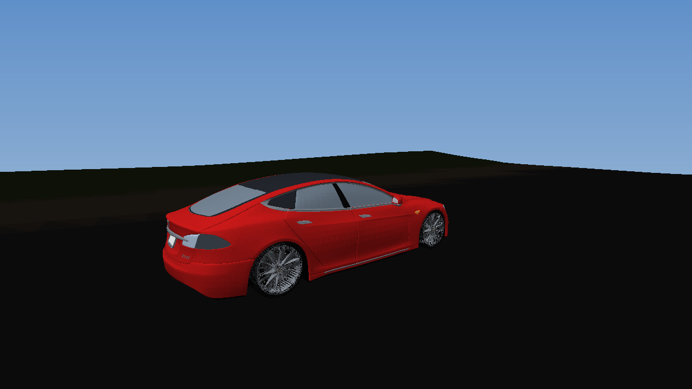

# SoftBody Drive — песочница мягкотельной физики в духе BeamNG.drive

Игра-симулятор на **чистом JavaScript (ES-модули) + WebGL2**, без сборки и без сторонних
библиотек. Машина — та самая модель `Tesla_Model_S_game.fbx` из этого репозитория,
разобранная на отдельные части (`Body`, `Wheel_FL/FR/RL/RR`) и подвешенная на
**мягкотельную (soft-body) раму из 240 узлов и 1224 балок**. Кузов реально мнётся:
балки имеют предел текучести и предел прочности, при ударе они пластически деформируются
и рвутся — как в BeamNG.drive, а не как в аркадном «минус 10% здоровья».



> На картинке — кадр, отрисованный тем же кодом скиннинга, но программным
> растеризатором (`tools/raster.py`), потому что в песочнице нет браузера.
> В браузере это рисуется шейдерами WebGL2 с тенями, небом и эффектами.

---

## Как запустить

```bash
node serve.js 8080      # или: npm start
```

Открыть <http://localhost:8080> в любом браузере с WebGL2 (Chrome, Edge, Firefox, Safari 15+).
Сборка не нужна — статика отдаётся нулевым по зависимостям сервером `serve.js`.

Альтернатива: любой статический сервер с корнем в `game/`
(`python3 -m http.server -d game 8080`).

## Управление

| Клавиша | Действие |
|---|---|
| `W` / `↑` | газ |
| `S` / `↓` | тормоз / назад |
| `A` `D` / `←` `→` | руль |
| `Space` | ручник |
| `R` | починить и вернуть машину на дорогу |
| `P` | поставить машину на бетонный полигон (там же — «крэш-тесты») |
| `C` | камера: погоня → облёт → от капота |
| `T` | замедление времени (слоу-мо для разглядывания деформаций) |
| `G` | показать каркас физики (видно, какие балки разорваны) |
| `F` | пауза |
| `H` | справка |
| мышь | вращение камеры, колесо — зум |

Геймпад тоже работает (левый стик + RT/LT).

## Что внутри

### Физика (главное)

* **Мягкотельная рама** (`game/src/physics/softbody.js`). 240 узлов (15 колец × 16
  секторов, зеркально-симметрично, генерируются `tools/gen_body_nodes.py` из модели) и
  1224 балки: кольцевые, продольные, диагональные (крутильная жёсткость) и длинные
  рельсы.
* **Неявное решение по осям балок** (backward Euler на осевой DOF каждой пары узлов).
  Безусловно устойчиво при любом `dt`, поэтому рама может быть жёсткой и не взрываться.
  Шаг симуляции `1/360 с`, до 9 подшагов на кадр.
* **Пластичность и разрушение**: при деформации выше `yieldStrain` балка получает
  остаточную деформацию, её жёсткость падает, а выше `breakStrain`/`breakForce` она
  рвётся. Именно это даёт «заломы» и смятые зоны, а не просто сдвиг модели.
* **Демпфирование только деформаций**: общая поступательная скорость узлов вычитается
  перед демпфированием и возвращается после — иначе рама работает как парашют.
* **Трение Кулона** в контакте с землёй и препятствиями (импульс трения не больше
  `mu × нормальный импульс`) — иначе колесо получало бесконечный тормоз.
* **Подвеска**: рейка-пружина на каждый угол, ход считается от реального положения
  деформированного кузова, демпферы сжатия/отбоя различаются, стабилизаторы поперечной
  устойчивости спереди и сзади. Углы, за которые крепится колесо, могут оторваться —
  колесо улетает и катится отдельным телом.
* **Шины**: модель бокового увода с пиком на малом угле скольжения, эллипс трения,
  продольное проскальзывание при пробуксовке, разные коэффициенты для асфальта, бетона,
  травы и грунта.
* **Привод**: полный (40/60), электромотор 410 кВт с падающим моментом, рекуперация
  через тормоз, ограничение по сцеплению, потеря тяги пропорционально повреждениям.
* **Аэродинамика**: сопротивление и прижимная сила, разделённая по осям.

### Рендер

* WebGL2, один проход с картой теней, процедурное небо с градиентом и солнцем,
  ландшафт с раскраской по материалам, деревья/отбойники, следы шин (кольцевой буфер),
  частицы пыли/дыма/искр.
* **GPU-скиннинг кузова**: 240 узлов рамы загружаются в `sampler2D` (5 текселей на узел:
  позиция, три столбца локального вращения, позиция покоя). Вершина смешивается по 4
  ближайшим узлам, нормали поворачиваются локальной матрицей. Колесо — жёсткий инстанс,
  ставится по реальному центру, углу поворота и спину.

### Остальное

* Трасса-кольцо длиной ~1.1 км, бетонный полигон 62 м, статические препятствия.
* ИИ-соперник (слежение по путевым точкам с ограничением скорости по кривизне,
  переворот/застревание — респавн).
* HUD: спидометр, полосы газа и тормоза, повреждения по углам, индикатор потерянных
  колёс, G-метр, FPS.
* Звука нет — в песочнице нечем проверить, не стал тащить.

## Тесты

```bash
npm test                 # всё сразу
npm run test:physics     # физика: посадка, разгон, торможение, поворот, краш, перф
npm run test:skin        # скиннинг: bind-поза, ортонормальность, эквивариантность
npm run test:render      # весь кадр против мок-WebGL2: имена uniform/атрибутов
```

Что даёт:

* посадка на дорогу: 4 колеса по 3.2–3.9 кН, кузов ровно, `damage 0`;
* 0–100 км/ч за **3.3 с**, торможение 106 → 0 за ~1.7 с;
* краш на 100 км/ч в препятствие: кузов вминается, балки рвутся, колёса отрываются;
* скиннинг: ошибка bind-позы `8e-6 м`, матрицы ортонормальны с точностью `3e-8`,
  при жёстком повороте кузова на 59° расхождение `4e-3 м`;
* производительность: **~10× реального времени** на одном ядре Node (физика без рендера);
* кадр: 30 720 `drawElements`, все uniform'ы и атрибуты разрешаются в своих программах.

Отдельно `node tools/cpu_render.mjs <сценарий> && .venv/bin/python tools/raster.py`
рисует PNG программно — так проверялась геометрия без браузера.

## Структура

```
game/
  index.html, styles.css          интерфейс и HUD
  assets/tesla.glb                машина, сконвертированная из .fbx
  src/
    core/math.js                  векторы, матрицы, утилиты
    physics/softbody.js           рама: балки, пластичность, контакты
    vehicle/cage.js               геометрия рамы, колёса, параметры балок
    vehicle/tesla_nodes.js        сгенерированные узлы рамы (240)
    vehicle/vehicle.js            машина: подвеска, шины, привод, повреждения
    vehicle/carMesh.js            glb → вершинные данные + веса скиннинга
    world/terrain.js              ландшафт, трасса, материалы, препятствия
    render/                       gl.js, shaders.js, loader.js, renderer.js
    fx/effects.js                 частицы и следы шин
    game/                         input.js, camera.js, hud.js, ai.js
    main.js                       цикл игры
tools/                            конвертер FBX→GLB, генератор рамы, CPU-растеризатор
tests/                            физика, скиннинг, мок-рендер
serve.js                          статический сервер (без зависимостей)
```

## Про исходную модель

`Tesla_Model_S_game.fbx` (FBX 7400, бинарный) разбирается своим парсером
`tools/fbx_dump.py` и конвертируется в glTF (`tools/fbx2glb.py`): 5 узлов
(`Tesla` → `Body`, `Wheel_*`), 9.7 МБ, 70 359 вершин кузова и по 21 348 на колесо.
Оси при конвертации повёрнуты так, чтобы в игре «вперёд» было `+Z`, «вверх» — `+Y`.
Рама строится вокруг этой геометрии скриптом `tools/gen_body_nodes.py`, так что
модель и физика всегда согласованы.

## Ограничения

* Нет звука.
* Нет сохранений, таблицы рекордов и полноценной гонки — это песочница.
* Модель повреждений визуально грубее, чем в BeamNG (240 узлов против десятков тысяч),
  поэтому мелкие вмятины не видны, зато крупные заломы читаются хорошо.
* Работа проверена headless-тестами и CPU-растеризатором; живьём в браузере
  в этой среде запустить нельзя (нет браузера), но никаких платформенных
  зависимостей, кроме WebGL2, у кода нет.
